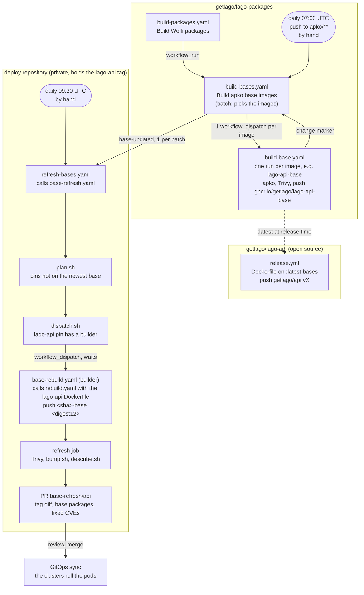

# lago-packages

Hardened [Wolfi](https://github.com/wolfi-dev)-based base images for Lago, built
with [apko](https://github.com/chainguard-dev/apko) and published to GHCR, plus
the few [melange](https://github.com/chainguard-dev/melange) recipes that build
the apks Wolfi does not ship for us.

These images carry no shell history, no apt, no distro cruft. Every package has
an SBOM, and every image is signed with cosign (keyless, via GitHub OIDC).

## Images

| Image | Contents | Consumed by |
| --- | --- | --- |
| `ghcr.io/getlago/lago-api-base` | ruby-4.0, jemalloc, libpq, pdfcpu, git, postgresql-client, curl | runtime stage of `lago-api` |
| `ghcr.io/getlago/lago-api-build` | ruby-4.0 + headers, build-base, rust, nodejs, clang-19 | build stage of `lago-api` |
| `ghcr.io/getlago/lago-front-base` | nginx, unprivileged (binds an unprivileged port) | runtime stage of `lago-front` |
| `ghcr.io/getlago/lago-front-build` | nodejs-24, pnpm | build stage of `lago-front` |
| `ghcr.io/getlago/data-agent-base` | python-3.13, nonroot | runtime stage of `lago-data-agent` |
| `ghcr.io/getlago/data-agent-build` | python-3.13 + headers, uv, git, build-base | build + model-vendoring stages of `lago-data-agent` |
| `ghcr.io/getlago/dbt-pipeline-base` | python-3.11, postgresql-17-client, bash, git, nonroot, no busybox | runtime stage of `lago-data-pipeline` (lago-data `data_pipeline/`) |
| `ghcr.io/getlago/dbt-pipeline-build` | python-3.11, uv, git | build stage of `lago-data-pipeline` |
| `ghcr.io/getlago/events-processor-base` | minimal runtime | runtime stage of `events-processor` |
| `ghcr.io/getlago/events-processor-build` | go, rust, cargo | build stage of `events-processor` |
| `ghcr.io/getlago/gotenberg-base` | chromium, libreoffice-25.8, openjdk-21-jre, qpdf, exiftool, python-3.11, fonts | runtime stage of `lago-gotenberg` |
| `ghcr.io/getlago/gotenberg-build` | go-1.27, build-base, git | build stage of `lago-gotenberg` |
| `ghcr.io/getlago/lago-metabase-base` | openjdk-21-jre, fontconfig, Noto/Liberation fonts | runtime for the metabase JAR wrapper |
| `ghcr.io/getlago/lago-metabase` | above base + upstream metabase JAR (pinned in `dockerfiles/lago-metabase/METABASE_VERSION`) | metabase Deployment |
| `ghcr.io/getlago/license-base` | ruby-4.0, libpq, make | runtime stage of `lago-license` |
| `ghcr.io/getlago/license-build` | ruby-4.0 + headers, build-base, postgresql-dev, yaml-dev | build stage of `lago-license` |
| `ghcr.io/getlago/mcp-server-base` | libssl3, glibc, nonroot | runtime stage of `lago-mcp-server` |
| `ghcr.io/getlago/mcp-server-build` | rust, openssl-3.6 headers, pkgconf, build-base | build stage of `lago-mcp-server` |
| `ghcr.io/getlago/oauth-proxy-base` | ruby-4.0, make | runtime stage of `lago-oauth-proxy` |
| `ghcr.io/getlago/oauth-proxy-build` | ruby-4.0 + headers, build-base, yaml-dev | build stage of `lago-oauth-proxy` |
| `ghcr.io/getlago/ratelimit-service-base` | minimal static runtime (ca-certificates, tzdata) | runtime stage of `ratelimit-service` |
| `ghcr.io/getlago/ratelimit-service-build` | go-1.26 (CGO off) | build stage of `ratelimit-service` |
| `ghcr.io/getlago/rev-rec-base` | python-3.13, openjdk-17-jre, nonroot | both roles of the `rev-rec` Beam pipeline |
| `ghcr.io/getlago/rev-rec-build` | python-3.13 + headers, uv, build-base | build stage of `rev-rec` |
| `ghcr.io/getlago/rev-rec-flink-base` | flink-1.20 (overlay), openjdk-17-jre, jemalloc, flink uid 9999 | JobManager/TaskManager image of `rev-rec` |
| `ghcr.io/getlago/rev-rec-flink-build` | go, git | Beam `boot` build stage of the `rev-rec` flink image |
| `ghcr.io/getlago/flink-paimon-base` | flink-1.20 (overlay), openjdk-17-jre, jemalloc, flink uid 9999 | runtime of `infra/flink-paimon` (lago-infrastructure) |
| `ghcr.io/getlago/flink-paimon-build` | openjdk-17 (JDK), bash, nonroot | build stages and tests of `infra/flink-paimon` |
| `ghcr.io/getlago/self-billing-base` | python-3.13, nonroot, no shell | runtime stage of `lago-self-billing` |
| `ghcr.io/getlago/self-billing-build` | python-3.13, uv, busybox | build stage of `lago-self-billing` |
| `ghcr.io/getlago/superset-base` | python-3.12, libstdc++, nonroot, no shell | runtime stage of `data/superset` (lago-data `dashboards/`) |
| `ghcr.io/getlago/superset-build` | python-3.12 + headers, uv, build-base, openssl | build and dev stages of `data/superset` |
| `ghcr.io/getlago/sidekiq-web-base` | ruby-3.4, nonroot | runtime stage of `sidekiq-web` |
| `ghcr.io/getlago/sidekiq-web-build` | ruby-3.4 + headers, build-base, openssl-dev, yaml-dev | build stage of `sidekiq-web` |
| `ghcr.io/getlago/argo-workflows-server-base` | minimal runtime (ca-certificates, tzdata), argo uid 8737 | runtime stage of `argo-workflows-server` |
| `ghcr.io/getlago/argo-workflows-server-build` | go-1.26, nodejs-20, yarn, git, patch, make, bash, build-base | build stages of `argo-workflows-server` |
| `ghcr.io/getlago/zitadel-login-base` | nodejs-24, busybox, nonroot | runtime stage of the Lago-branded zitadel login app |
| `ghcr.io/getlago/zitadel-login-build` | nodejs-24, pnpm, git, patch, build-base | build stage of the zitadel login app |

All are multi-arch (`x86_64`, `aarch64`).

## Tags

- `:<YYYYMMDD>-r<run>` — immutable, one per publish. Pin to this (or to the digest) for reproducible builds. `<run>` is the `build-base.yaml` run number + 1000, which keeps it above the tags of the older matrix build.
- `:<commit-sha>` — immutable: set only the first time a commit publishes.
- `:latest` — the newest publish. Rebuilt daily so it stays within ~24h of upstream Wolfi.
- `:<YYYYMMDD>-r<run>-<arch>`, `:latest-<arch>` — the per-arch images behind the tags above.

The daily rebuild is the point: Wolfi publishes CVE patches multiple times a day,
and `:latest` picks them up without anyone opening a PR.

apko builds are reproducible, so a rebuild with the same apk set gives the same
digest. A base is published only when its digest changes. The `notify` job of
the batch then sends a `base-updated` `repository_dispatch` to the deploy
repositories (the private repositories that hold the deployed tags). There, the
base refresh rebuilds the deployed images on the new digests and bumps their
GitOps tags: see [Base refresh](#base-refresh-for-consumers).

The dispatch needs the `BASE_UPDATE_DISPATCH_TOKEN` secret (a token with
`contents: write` on each deploy repository). The deploy repositories also run
the refresh daily, so a missed dispatch only delays a refresh.

## Base refresh (for consumers)

A new base fixes nothing until the images built on it are rebuilt and
deployed.

### Flow

Example: the `lago-api` image, on `lago-api-base` and `lago-api-build`.



- A release of lago-api builds its `Dockerfile` on the `:latest` bases of that
  day. Nothing in this repository starts it.
- A deployed image stays on the base it was built on. The base refresh rebuilds
  the **deployed commit** on the new base and opens a PR with the new tag.
- An image that needs no secret has no `builder`: the deploy repository builds
  it in its `build` job.
- The lago-api build needs a secret (the Sidekiq Pro credential), so the deploy
  repository is also its `builder`: its `base-rebuild.yaml` checks out the
  deployed lago-api commit and calls `rebuild.yaml`.

GitHub does not make links in a mermaid diagram clickable. Use this table:

| Step | Runs | Source |
| --- | --- | --- |
| Build Wolfi packages | [runs](https://github.com/getlago/lago-packages/actions/workflows/build-packages.yaml) | [`build-packages.yaml`](.github/workflows/build-packages.yaml) |
| Base batch | [runs](https://github.com/getlago/lago-packages/actions/workflows/build-bases.yaml) | [`build-bases.yaml`](.github/workflows/build-bases.yaml) |
| One base image | [runs](https://github.com/getlago/lago-packages/actions/workflows/build-base.yaml) | [`build-base.yaml`](.github/workflows/build-base.yaml), [`apko/lago-api-base.yaml`](apko/lago-api-base.yaml) |
| Base images | [packages](https://github.com/orgs/getlago/packages?repo_name=lago-packages) | [`apko/`](apko) |
| lago-api release | [runs](https://github.com/getlago/lago-api/actions/workflows/release.yml) | [`Dockerfile`](https://github.com/getlago/lago-api/blob/main/Dockerfile), [`release.yml`](https://github.com/getlago/lago-api/blob/main/.github/workflows/release.yml) |
| Refresh (deploy repository) | private | [`base-refresh.yaml`](.github/workflows/base-refresh.yaml), [scripts](.github/actions/base-refresh) |
| Rebuild (builder) | in the builder repository | [`rebuild.yaml`](.github/workflows/rebuild.yaml) |

A failed base image is a red `build-base.yaml` run named after the image. The
batch run stays green and lists every image run in its summary. The other
images still publish, and the batch still sends `base-updated`. The batch turns
red only when it cannot start an image run.

`base-updated` comes from the batch, once, for the images that changed while it
waited. An image run sends its own when the batch does not cover it:

- started by hand (`notify` defaults to true),
- a re-run, for example of a red image after its fix,
- it ended after the batch stopped waiting (110-minute deadline, or the batch
  was cancelled).

To rebuild one image, run `build-base.yaml` by hand with its `image` input.

To trace a deployed tag `<release>-base.<digest12>`:

1. Open its bump PR. The body has the base build, the refresh run, the base
   packages that changed and the CVEs that the new base fixes.
2. Without the PR: `<digest12>` is the start of the base index digest. The
   index names the run that published it:

   ```sh
   for t in $(crane ls ghcr.io/getlago/<base> | grep -E '^[0-9]{8}-r[0-9]+$'); do
     crane digest ghcr.io/getlago/<base>:$t | grep -q '^sha256:<digest12>' && echo "$t"
   done
   crane manifest ghcr.io/getlago/<base>:<that tag> | jq -r '.annotations["dev.getlago.build-run"]'
   ```

   A base published before the annotation existed has none. Its run number is
   in the tag.

### Repositories

Three kinds of repository take part:

| Repository | Does | Workflow |
| --- | --- | --- |
| lago-packages | publishes a base, sends `base-updated` | `build-bases.yaml` |
| deploy repository (holds the tags) | plans, waits for the rebuild, scans it, opens the bump PR | calls `base-refresh.yaml` |
| `builder` (e.g. lago-api) | rebuilds the **deployed commit** with its own secrets | `base-rebuild.yaml`, calls `rebuild.yaml` |

The new tag is `<release>-base.<digest12>`. A pin with no `builder` is built
by the repository that holds the tag, for an image that needs no secret.

```yaml
# Holds the tags: .github/workflows/refresh-bases.yaml
on:
  repository_dispatch: {types: [base-updated]}   # sent by build-bases.yaml
  schedule: [{cron: '30 9 * * *'}]
  workflow_dispatch:
concurrency: {group: refresh-bases, cancel-in-progress: false}   # one refresh at a time
jobs:
  refresh:
    permissions: {contents: read, id-token: write, packages: write}
    uses: getlago/lago-packages/.github/workflows/base-refresh.yaml@<sha>   # pin by SHA
    with:
      pins: .github/base-refresh/pins.yaml
      ecr-role: arn:aws:iam::<account>:role/<pulls the pinned repos>
      ecr-push-role: arn:aws:iam::<account>:role/<pushes the in-place images>   # only if some pin has no builder
    secrets:
      pr-token: ${{ secrets.BASE_REFRESH_PR_TOKEN }}
```

```yaml
# Builder: .github/workflows/base-rebuild.yaml (must be on the default branch)
name: Base rebuild
run-name: base rebuild ${{ inputs.tag }} ${{ inputs.nonce }}   # dispatch.sh finds the run by the nonce
on:
  workflow_dispatch:
    inputs:
      commit: {type: string, required: true}
      base: {type: string, required: true}
      tag: {type: string, required: true}
      name: {type: string, required: false}
      nonce: {type: string, required: false}
jobs:
  rebuild:
    permissions: {contents: read, id-token: write, packages: write}   # the shared build asks for these
    uses: getlago/lago-packages/.github/workflows/rebuild.yaml@<sha>   # pin by SHA
    with:
      commit: ${{ inputs.commit }}
      base: ${{ inputs.base }}
      tag: ${{ inputs.tag }}
      image-name: <registry>/<repository>
      role-to-assume: <OIDC push role>   # or the registry-user/registry-token secrets
    secrets:
      build-secrets: |
        <id>=${{ secrets.<SECRET> }}
```

Pins file: one entry per place a tag is pinned. Entries that share `name` go
in one PR.

| Field | |
| --- | --- |
| `name` | image name, and the PR branch `base-refresh/<name>` |
| `base` | the `ghcr.io/getlago/<base>` the image runs on |
| `file`, `path` | the YAML file and the yq path of the tag, or of a full `repository:tag` |
| `repository` | full image repository (or `<ecr input>/<name>`) |
| `source`, `dockerfile` | the repository and Dockerfile of the image (commit lookup, `ARG RUNTIME_IMAGE` check) |
| `builder` | the repository whose `base-rebuild.yaml` rebuilds it (`builder-ref`: its branch, for a test) |
| `context` | build context, for an image with no `builder` |

The deployed tag must be `<commit>`, `<word>-<commit>` or either with
`.build-<n>`. A pin is skipped while its Dockerfile at the deployed commit has
no `ARG RUNTIME_IMAGE`, so a pin can be added before the image moves to a
lago-packages base.

`pr-token`, fine-grained: contents + pull requests write on the repository
that holds the tags, contents read on each `source`, actions write on each
`builder`. Actions write can start any workflow of the builder, so a builder
should have no other `workflow_dispatch` workflow that deploys.

`rebuild.yaml` accepts only a full commit SHA, a `ghcr.io/getlago/<base>@sha256:`
base and a `<release>-base.<digest12>` tag that matches that base: a dispatch
cannot inject build args or push a release tag. `base-refresh.yaml` checks out
its scripts at its own commit (the `job_workflow_sha` OIDC claim), so pinning
the workflow by SHA also pins the scripts.

## Pinned downloads (Renovate)

A Dockerfile that downloads a release pins it by version and sha256. Annotate
each pin so Renovate can move it:

```dockerfile
# renovate: datasource=github-releases depName=gotenberg/gotenberg
# sha256: https://github.com/gotenberg/gotenberg/archive/refs/tags/${VERSION}.tar.gz
ARG GOTENBERG_VERSION=v8.39.0
ARG GOTENBERG_SHA256=11b3ec38...
```

1. Extend `github>getlago/lago-packages//renovate/pinned-downloads` (add
   `custom.regex` to `enabledManagers` if the repository sets them).
   Renovate opens one `renovate/pinned-downloads` PR, 3 days after a release.
2. On that PR, run the `.github/actions/pinned-downloads` action (pinned by
   SHA). It recomputes each `*_SHA256` whose `*_VERSION` changed and pushes
   the fix. The PR's build then verifies the bytes. An unchanged version
   keeps its hash, so bytes that move under a tag fail the build.

Example: getlago/lago-gotenberg `.github/workflows/pr.yaml`.

## Verifying

```sh
cosign verify ghcr.io/getlago/lago-api-base:latest \
  --certificate-identity-regexp '^https://github.com/getlago/lago-packages/' \
  --certificate-oidc-issuer https://token.actions.githubusercontent.com
```

### SBOMs

apko emits an SPDX SBOM per arch on every build. Each one is attached to its
per-arch image as a cosign attestation, and uploaded as a workflow artifact
(90 days). Attest against the **per-arch** tag — that is the digest a puller
resolves to:

```sh
cosign verify-attestation --type spdxjson \
  ghcr.io/getlago/lago-api-base:latest-x86_64 \
  --certificate-identity-regexp '^https://github.com/getlago/lago-packages/' \
  --certificate-oidc-issuer https://token.actions.githubusercontent.com \
  | jq -r '.payload | @base64d | fromjson | .predicate.name'
```

## Adding an image

Drop a new `apko/<name>.yaml` in. The build matrix is derived from `apko/*.yaml`,
so it needs no workflow change — the image publishes to `ghcr.io/getlago/<name>`.

Set `org.opencontainers.image.source` to this repository. GHCR uses that
annotation to link the package back to its source, which is what inherits repo
permissions and makes provenance visible on the package page.

## The package overlay (`packages/`)

Wolfi carries almost everything our images need. `packages/` holds a melange
recipe for each exception — today only `chromium`, where Wolfi is months behind
the CVE fixes gotenberg needs, `ruby-4.0`, which Wolfi has since caught up
on, and `flink-1.20`, which Wolfi does not ship (2.x only) and Beam's
FlinkRunner needs. Each recipe builds an apk for both arches, signed with the Lago melange key
and published to the private S3 bucket `lago-wolfi-packages`.

A manifest opts into the overlay by naming it as a repository:

```yaml
contents:
  repositories:
    - https://packages.wolfi.dev/os
    - ./repo-local
  keyring:
    - https://packages.wolfi.dev/os/wolfi-signing.rsa.pub
    - ./repo-local/lago-signing.rsa.pub
```

`./repo-local` is the marker the workflow greps for. A manifest without it never
assumes the AWS role and never downloads the overlay.

**apk installs the highest version it can see.** The overlay sits beside Wolfi,
it does not replace it, so a recipe only wins while its version is above Wolfi's.
That is deliberate for `chromium` and it is why the workflow's `aws s3 sync`
pulls an explicit allowlist of apks rather than the whole bucket.

### Changing a recipe

Edit `packages/<name>.yaml` and push. Two workflows run, in order:

1. `build-packages.yaml` builds the apk on both arches, re-signs the index and
   publishes to S3.
2. `build-bases.yaml` starts on `workflow_run` and rebuilds every manifest that
   names `./repo-local`.

So one merge produces the new `ghcr.io/getlago/<base>:<sha>` tag. Pin that tag in
the consuming repo and you are done.

The chaining is the point. Both workflows watch `main`, so a recipe push that
also touched `apko/` would otherwise rebuild the image beside the package build
and sync the apk the bucket held *before* the merge.

The daily cron rebuilds images only. A recipe pins one upstream version, so
rebuilding it on a timer would republish identical bytes.

### Key material

The signing key is a `tls.PrivateKey` owned by a Pulumi project in our private
infrastructure repository. That project generates it, mirrors it to
1Password, writes the private half to this repo as the `MELANGE_SIGNING_KEY`
Actions secret, publishes the public half to `s3://lago-wolfi-packages/os/` for
apko's keyring, and publishes the bucket role ARN here as `PACKAGES_ROLE_ARN`.
Nothing in this repo creates or rotates it.

## Build pipeline

`build-packages.yaml` builds apks, `build-bases.yaml` builds images and chains
off it. Inside `build-bases.yaml`, `discover` picks the manifests this event
needs, and `dispatch` starts one `build-base.yaml` run per manifest and waits
for them. Each image has its own run, so a failure is easy to find and does not
turn the other images red. To rebuild one image, run `build-base.yaml` by hand
with its `image` input.

`apko build` produces a local multi-arch OCI tarball, Trivy scans that tarball
for fixable HIGH/CRITICAL CVEs, and only then does crane push the *exact* bytes
that were scanned. There is no rebuild between scan and push, so nothing can
drift into the registry unscanned.

### Ignoring fixable CVEs that Wolfi hasn't shipped yet

Sometimes Trivy flags a CVE as fixable because upstream released a patched
version, but Wolfi hasn't packaged it into its apk repo yet (typical on
fast-moving trees like `chromium`). Drop those CVE IDs into
`.trivyignore.d/<manifest-name>` and Trivy will treat them as accepted
exceptions on both arches until the next successful rebuild.

Every entry needs a comment explaining the source of the CVE and the trigger
that clears it (usually "Wolfi bumps `<package>` past `<version>`"). Trivy
silently skips ignore IDs that don't match any current finding, so prune the
file whenever the daily rebuild passes cleanly.
